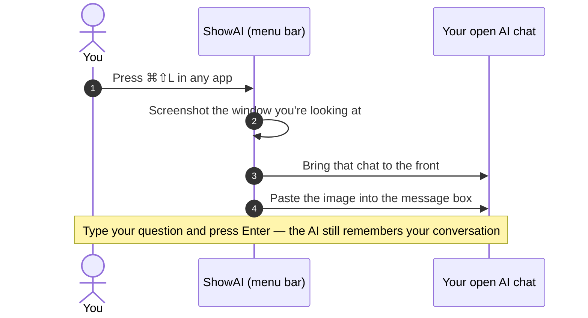

<div align="center">


# ShowAI

**Stuck on something? Press one key — a screenshot lands in the AI chat you already have open, ready for your question.**


**[Install](#-install-30-seconds) · [First-time setup](#-first-time-setup-2-minutes) · [Use it](#-everyday-use) · [Set & forget](#-set-it-and-forget-it) · [Updates](#-automatic-updates) · [Help](#-troubleshooting) · [Privacy](#-privacy) · [Uninstall](#-uninstall)**

</div>

---

## 💡 How it works

You're stuck on an error, a design, a settings screen. Normally you'd screenshot it, find the file, switch to your AI chat, find the right tab, attach, and explain. With ShowAI:



- **It goes into the conversation you already have**, so the AI keeps all its context. No new chat, no re-explaining.
- **It never sends anything for you.** It only pastes the image; you write and send the message.
- **It works with almost any AI chat:**

| In Google Chrome | | | Desktop apps |
|---|---|---|---|
| ChatGPT | Claude | Gemini | ChatGPT app |
| Google AI Studio | Perplexity | Microsoft Copilot | Claude app |
| Grok | DeepSeek | Mistral Le Chat | |
| Meta AI | Poe | Qwen · Kimi | |

Using another AI chat website? Add it in one step — see [Add any AI chat](#add-any-other-ai-chat).

---

## 📦 Install (30 seconds)

Open **Terminal** (press ⌘Space, type *Terminal*, press Return), paste this line and press Return:

```sh
curl -fsSL https://github.com/jayz6/showai-releases/releases/latest/download/install.sh | sh
```

That's it. The installer:

1. checks you're on **macOS 14 or newer** (Apple Silicon Mac — M1 or later),
2. downloads the latest ShowAI,
3. puts **ShowAI.app** in your **Applications** folder,
4. starts it — you'll see *"ShowAI is running — press ⌘⇧L"* at the top right.

> No Apple "can't be opened" warning, no dragging to Applications, no account needed.

<details>
<summary><b>Prefer to read the installer first?</b></summary>

Good instinct. View it here: [install.sh](https://github.com/jayz6/showai-releases/releases/latest/download/install.sh). It only downloads `ShowAI.zip` from this page's latest release, copies the app to `/Applications`, and opens it.
</details>

---

## 🔐 First-time setup (2 minutes)

On first launch ShowAI opens a small **welcome window** with three permissions. Each row turns green ✅ as soon as you grant it, and the window closes itself when the required ones are done.

| Permission | Why ShowAI needs it | Required? |
|---|---|---|
| **Screen Recording** | to take the screenshot | ✅ yes |
| **Accessibility** | to press ⌘V for you and bring the right chat window forward | ✅ yes |
| **Control Chrome** | to find and switch to your AI chat tab in Chrome | optional (needed for Chrome chats) |

**Step by step:**

1. **Screen Recording** → click **Open Settings** → turn on **ShowAI** → back in the welcome window, click **Relaunch ShowAI** (macOS needs a restart for this one).
2. **Accessibility** → click **Open Settings** → turn on **ShowAI**.
   On macOS 27 this list is called **Device Control and Data Access**; on older versions it's **Privacy & Security › Accessibility**.
3. **Control Chrome** (if you use AI chats in Chrome) → click **Allow** → macOS asks *"ShowAI wants to control Google Chrome"* → **OK**. Chrome must be open for this step.

You only do this once. Permissions stay granted through every update.

---

## ⌨️ Everyday use

| Press | What happens |
|---|---|
| **⌘⇧L** | Screenshot of the **window you're looking at** → pasted into your chat |
| **⌘⌥⇧L** | Drag to select **any area** of the screen → pasted (press **Esc** to cancel) |

Then type your question and press Enter, like always.

### Which chat gets the screenshot?

ShowAI picks for you, in this order:

1. a chat you **pinned** in the menu,
2. otherwise, if only **one** AI chat is open — that one,
3. otherwise, the chat you **used last**,
4. otherwise, the first open chat.

No AI chat open? You'll see *"No AI chat found — open one in Chrome or the ChatGPT/Claude app first."*

### The menu-bar menu

Click the 📸 **viewfinder icon** in the menu bar:

| Menu item | What it's for |
|---|---|
| **Sending to: …** | shows where your next screenshot will go |
| **Auto (last chat used)** / a chat name | pick **Auto**, or click a chat to **pin** it as the target |
| **Capture: Front window / Area** | what the plain hotkey captures |
| **Add AI Chat Website…** | teach ShowAI another AI chat site |
| **Change Hotkey…** | choose your own shortcut (must include ⌘ or ⌃, not ⌥) |
| **Launch at Login** | start ShowAI automatically |
| **Permissions…** | re-open the setup window |
| **Check for Updates…** / **Automatically Check for Updates** | updates (on by default) |
| **Quit ShowAI** | |

### Add any other AI chat

Menu › **Add AI Chat Website…** → type the address, e.g. `chat.mycompany.ai` → **Add**. From now on, Chrome tabs on that site count as chats. Remove it any time from the same menu.

> ShowAI deliberately doesn't treat *every* tab as a chat — that's what stops it from ever pasting into your email or docs by mistake.

---

## 🌙 Set it and forget it

Two clicks, once:

1. Menu › **Launch at Login** ✓ — ShowAI starts every time you log in, silently in the menu bar.
2. Leave **Automatically Check for Updates** ✓ on (it is by default).

After that there's nothing to maintain. ShowAI sits in your menu bar, waits for ⌘⇧L, and keeps itself up to date. Your hotkey, pinned chat, added websites and permissions all survive updates and restarts.

---

## 🔄 Automatic updates

- Once a day ShowAI checks this page for a newer version.
- When there is one, you'll see **"A new version of ShowAI is available!"** → click **Install Update** → **Install and Relaunch**. It takes a few seconds.
- Every update is **cryptographically signed**; ShowAI refuses anything that isn't signed by its own key.
- Want it now? Menu › **Check for Updates…**
- Don't want automatic checks? Untick **Automatically Check for Updates**.
- You can also update by running the install command again.

See what changed in each version on the [Releases](https://github.com/jayz6/showai-releases/releases) page.

---

## 🧯 Troubleshooting

<details>
<summary><b>I don't see the 📸 icon in the menu bar</b></summary>

- On MacBooks with a notch, extra menu-bar icons can hide behind it. Quit a few other menu-bar apps, or check an external display's menu bar.
- System Settings › **Menu Bar**: make sure ShowAI is allowed.
- Opening ShowAI again (from Applications) shows *"ShowAI is running"* and opens its menu.
</details>

<details>
<summary><b>"Couldn't bring the chat forward — try again"</b></summary>

ShowAI checks that the right chat is really in front before pasting, and gives up rather than paste into the wrong place. Usually Chrome was busy — press the hotkey again. If it keeps happening, make sure **Control Chrome** is allowed (menu › Permissions…).
</details>

<details>
<summary><b>"No window to capture"</b></summary>

You pressed the hotkey on the desktop or an app without a window. Click into the window you want, or use **⌘⌥⇧L** to drag an area.
</details>

<details>
<summary><b>The hotkey does nothing</b></summary>

Another app or a system shortcut may be using it. Menu › **Change Hotkey…** and pick another. If the menu shows *"⚠︎ Hotkey not active"*, that's the reason. (Note: ⌘⇧L is also VS Code's "Select All Occurrences" — ShowAI's wins while it runs.)
</details>

<details>
<summary><b>Screenshots are black or the welcome window keeps coming back</b></summary>

Screen Recording isn't granted (or macOS asked you to re-confirm it). Menu › **Permissions…**, turn it on, then **Relaunch ShowAI**.
</details>

<details>
<summary><b>Intel Mac?</b></summary>

Not supported yet — ShowAI currently runs on Apple Silicon Macs (M1 or later).
</details>

<details>
<summary><b>Safari / Arc / Firefox?</b></summary>

Not yet — Google Chrome and the ChatGPT/Claude desktop apps for now.
</details>

---

## 🔒 Privacy

- **Nothing leaves your Mac.** No account, no analytics, no tracking.
- Screenshots exist **only in memory and on your clipboard** (marked so clipboard managers skip them). They are never saved to disk.
- Only the window you're looking at is captured — not your whole screen — and only when you press the hotkey.
- The **only** network request ShowAI makes is the daily update check (a small file from this page), which you can switch off.

---

## 🗑 Uninstall

1. Click the 📸 icon › **Quit ShowAI**.
2. Delete the app: drag **ShowAI** from Applications to the Bin, or run `rm -rf /Applications/ShowAI.app`.
3. Optional — forget its settings too: `defaults delete app.showai.ShowAI`
4. Optional — remove its permissions: System Settings › Privacy & Security (Screen Recording, Accessibility / Device Control and Data Access, Automation) › select ShowAI › **–**.

---

<div align="center">
<sub>Requires macOS 14 or newer on an Apple Silicon Mac (M1 or later) · Made for people who'd rather ask than explain.</sub>
</div>
